# Ephesos

## Purpose
I use Ephesos to ask what a specified star and planetary system should look like
in a light curve. Orbital geometry, companion sizes, and surface brightness all
leave their mark. I want to see the effect of each assumption before trying to
infer it from observations.

The core workflow evaluates sky-projected brightness through `ephesos.eval_modl()`.
The concise `ephesos.evaluate_transit_model()` interface covers deterministic
single-companion transit calculations.

`eval_modl()` retains white plot backgrounds with black axes by default.
Pass `typeplotback='dark'` for a dark theme with white axes. The selection is
scoped to the call, including its plotting helpers, and restores the caller's
Matplotlib settings afterward. It does not change the calculated flux.

Animated examples show a planetary transit and two simultaneous transits:

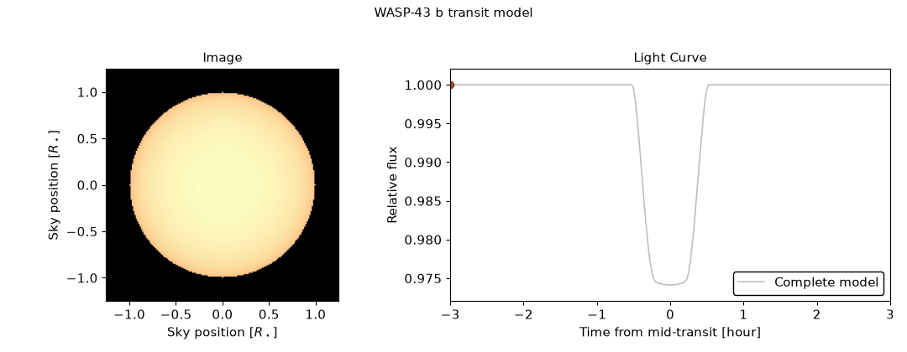

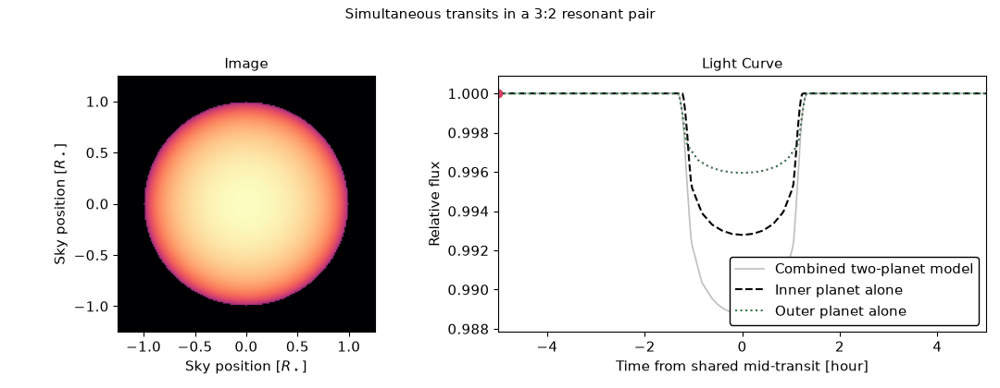

Ephesos predicts linear, sinusoidal, and N-body transit times.
`evaluate_sinusoidal_transit_times()` adds a sinusoidal timing variation to a
linear ephemeris. Its transit epochs and TTV period are in epochs, while all
times and the TTV amplitude are in days. `evaluate_nbody_transit_times()` uses
the optional `ttvfast` integrator and returns each planet's predicted epoch
indices and times in days. Each `planet_parameters` row contains mass [solar
masses], period [days], eccentricity, inclination [degrees], ascending-node
longitude [degrees], periapsis argument [degrees], and mean anomaly [degrees].
Its final argument is the absolute integration end time in days. Missing
transits are excluded without renumbering later epochs. The sinusoidal model is
phenomenological and does not calculate gravitational interactions.
For normalized observed light curves, `derive_transit_timing_variations()`
measures complete events in non-overlapping windows around a supplied linear
ephemeris. It returns contact-midpoint TTVs and durations in days, plus TDVs
relative to the median measured duration. Missing or edge-truncated events are
marked as `NaN`; this threshold-based estimator is not a transit-profile fit.

The Rømer example demonstrates how Io's eclipse-contact times shift as Earth
moves around the Sun. It generates synthetic immersions and emergences using
circular, coplanar Earth and Jupiter orbits and adds seeded 30-second timing
noise. The orbital elements and Io properties come from NASA NSSDCA's Earth,
Jupiter, and Jovian satellite fact sheets. The fit recovers the light speed
from the slope of timing delay against Earth-Jupiter distance. These are toy
observations, not Rømer's historical measurements. The historical reference is
Rømer (1676), ``Démonstration touchant le mouvement de la lumière``, *Journal
des sçavans*.

```bash
python examples/romer_light_time/romer_light_time.py --typefileplot png
```

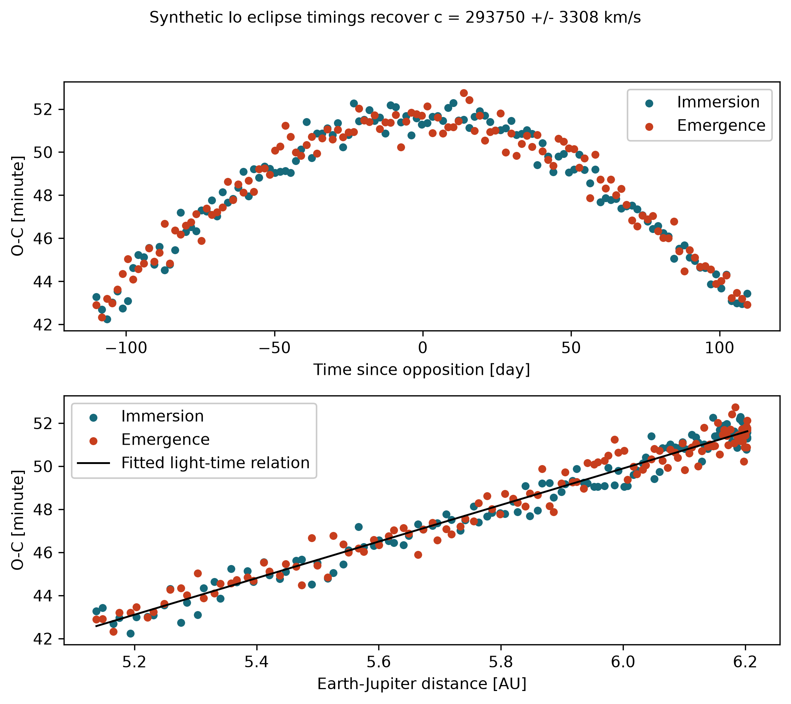

The eclipsing-binary example combines Ephesos's luminous-companion model with
its primary-star transit model. A planet crosses the primary between the
binary's primary and secondary eclipses. The independent ephemerides keep these
events separate, so the component flux changes can be added directly. The
secondary is a uniform-brightness sphere, and the calculation omits binary
reflex motion and three-body dynamics.

```bash
python examples/planet_in_eclipsing_binary/planet_in_eclipsing_binary.py --typefileplot png
```

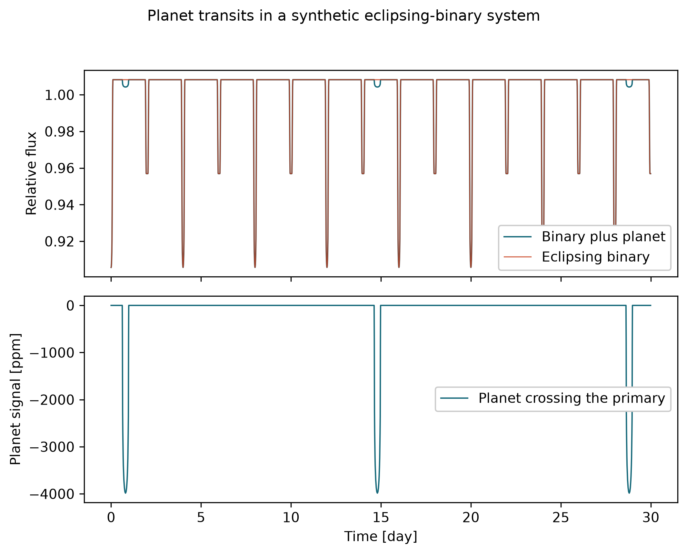

## Light-curve modeling
Choose the geometry and brightness model, then calculate the light curve. The
examples below show what changes when I add a moon, a disk, a comet-like tail,
or a nonuniform brightness map. Each model comes with its own approximations.

`evaluate_exomoon_transit_model()` combines a circular, coplanar planet and moon
on a limb-darkened stellar image grid. It accepts their radii and the moon's
orbital separation and period. `evaluate_planet_with_disk_model()` combines an
opaque planet with a thin, uniform annulus, including disk inclination, position
angle, and normal optical depth. The moon model holds the planet's stellar orbit
fixed, omits the planet's reflex motion, and does not enforce orbital stability.
The disk model omits scattering, vertical structure, and radial opacity
variations. The moon calculation scales as the number of time samples times the
square of the image-grid size. The disk calculation uses one grid convolution
followed by interpolation at each time sample.

`evaluate_exocomet_transit_model()` combines an opaque nucleus with a rasterized,
partially transparent trailing tail whose optical depth decays exponentially
away from the nucleus. It assumes a circular orbit and is a phenomenological
occultation model, not a dust-grain dynamics or comet-outgassing calculation.
Fractional custom-occultor masks are sampled with bilinear interpolation.

## Stellar activity

Use `ephesos.stellar_activity` for stellar-rotation, spot, and flare forward models. `retr_protlati(period, shear, latitude_degrees)` follows the latitude-dependent period law, $P(\theta)=P_{\rm eq}(1+\rho\sin^2\theta)$. Here $\rho$ is the fractional pole-to-equator period difference. The angular-velocity shear law uses a different coefficient.

`evaluate_spot_flare_model` natively integrates the visible portions of circular spots over a quadratically limb-darkened stellar disk, applies optional Gaussian spot evolution, and adds TDpy's fast-rise exponential-decay flares. Spots are spherical caps with angular radii equal to the arcsine of their supplied radius ratios. Rotation and inclination determine their visibility, including partial visibility at the limb. Times and evolution scales use days, angles use degrees, and radii, contrast, amplitudes, and flux offset are dimensionless. Longitude zero places an equatorial spot nearest the observer at time zero. The total is an independent sum of spot deficits, which neglects overlapping spots. Flare amplitudes follow the inherited TDpy convention and are maxima on the supplied sampling grid. Pass `return_components=True` to inspect the total, individual spots, evolved spots, and summed flares. `quadrature_order` defaults to 64. Increase it to check numerical convergence for your parameters.

```bash
python examples/differential_rotation/differential_rotation.py --typefileplot png
python examples/spot_flare/spot_flare.py --typefileplot png
```

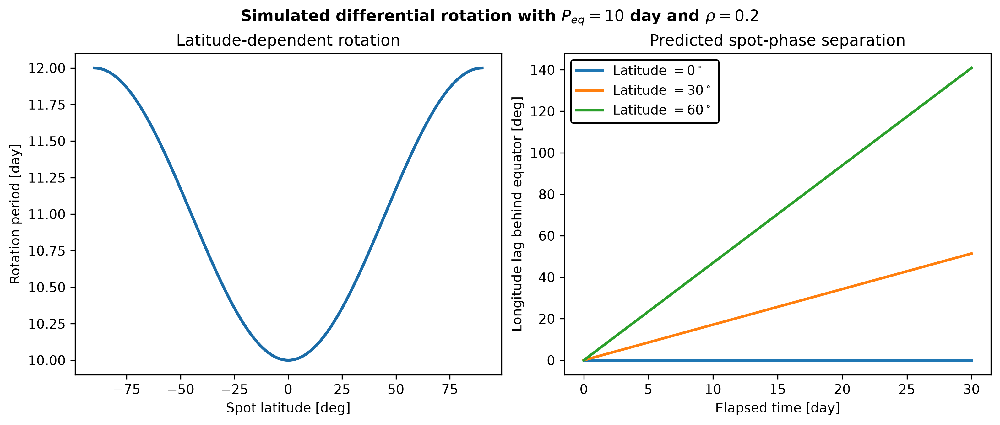

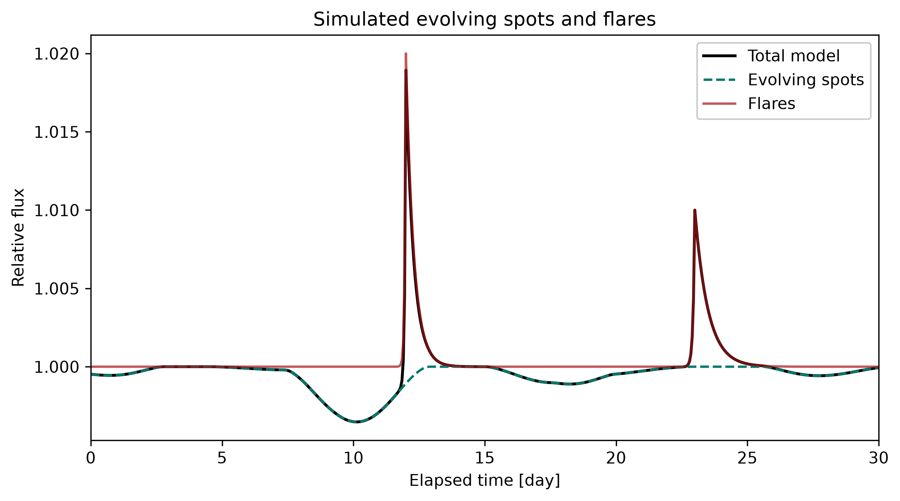

The rotation example assumes a 10-day equatorial period and relative period shear of 0.2. The spot-and-flare example spans 30 days with two evolving spots and two explicitly supplied flares. These are model predictions, not observed stars. Fitting, likelihoods, and target selection belong to Miletos. The original Hattusa MIT notice is retained in `LICENSE.Hattusa`.

## Installation

```bash
cd /path/to/ephesos
pip install -e .
export EPHESOS_PATH=/path/to/ephesos
```

For N-body transit-time predictions, install `pip install -e '.[ttv]'`.

Spotted-star predictions use the standard Ephesos installation and require no separate spot engine or NumPy downgrade.

For interactive Bokeh light curves, install `python -m pip install -e '.[bokeh]'`.

`EPHESOS_PATH` identifies the repository root. Runtime inputs belong under `data/`.
Generated pipeline outputs belong under `visuals/`. Git ignores both directories.

## Minimal usage

The runnable example evaluates a central transit with a three-day orbital period,
a companion-to-star radius ratio of 0.1, a summed-radius-to-semimajor-axis ratio
of 0.1, and quadratic limb darkening.

```bash
python examples/minimal_transit/minimal_transit.py --typefileplot png
```

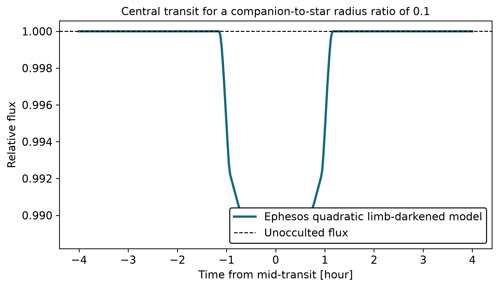

The curve is a deterministic prediction under these assumptions. It contains no
observed or randomly generated data. The model produces a 1.13% transit depth.

Single-system examples write compact GIFs without external data or
command-line animation tools. The population example writes a static corner plot
of features derived from the synthesized light curves.

```bash
python examples/minimal_transit/minimal_transit.py
python examples/PlanetsWithDisks/PlanetsWithDisks.py
python examples/exomoon/exomoon.py
python examples/exomoon/exomoon.py --bokeh
python examples/exomoon/exomoon_transit_times.py
python examples/arbitrary_occultor/arbitrary_occultor.py
python examples/astromusers_logo_occultor/astromusers_logo_occultor.py
python examples/compact_multiplanet/compact_multiplanet.py
python examples/emitting_companion/emitting_companion.py
python examples/known_self_lensers/known_self_lensers.py
python examples/eclipse_mapping/eclipse_mapping.py
python examples/orbital_geometry/orbital_geometry.py
python examples/run_WhiteDwarf/run_WhiteDwarf.py
python examples/run_WASP43/run_WASP43.py
python examples/run_population/run_population.py
python examples/self_lensing/self_lensing.py
python examples/photodynamical_ttv/photodynamical_ttv.py
python examples/transits_simultaneous/transits_simultaneous.py
```

The photodynamical TTV example uses TTVFast to integrate a near-3:2 planetary
pair and plots each planet's predicted transit times minus its fitted linear
ephemeris. Planet masses use solar masses, periods and integration times use
days, and orbital angles use degrees. Install the optional ``ttv`` extra to run
the example.

The orbital-geometry example shows a deterministic three-planet system from the
top down before and after each Z-X-Z Euler rotation. Additional panels use
orthographic projections at arbitrary azimuth and elevation angles or perspective
views from finite observer positions. The example places one observer inside the
innermost orbit.

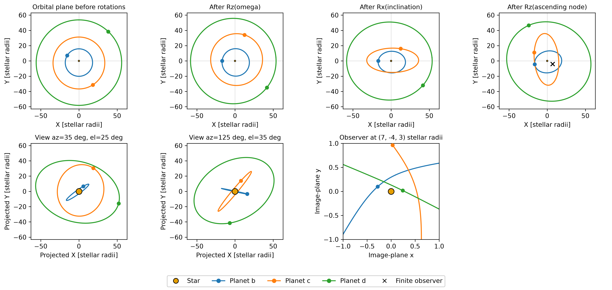

## Notebook examples

Five executable notebooks provide interactive entry points to complementary
capabilities:

- [`examples/capabilities/capabilities.ipynb`](examples/capabilities/capabilities.ipynb)
	inspects the installed API, evaluates transit, self-lensing, and projected-ring
	models, checks failure behavior, and benchmarks representative calls using
	deterministic simulated systems.
- [`examples/known_self_lensers/known_self_lensers.ipynb`](examples/known_self_lensers/known_self_lensers.ipynb)
	compares bundled public Kepler observations with Ephesos self-lensing models.
- [`examples/PlanetsWithDisks/PlanetsWithDisks.ipynb`](examples/PlanetsWithDisks/PlanetsWithDisks.ipynb)
	compares deterministic equal-area spherical and circumplanetary-disk silhouettes.
- [`examples/exomoon/exomoon.ipynb`](examples/exomoon/exomoon.ipynb)
	compares toy leading- and trailing-moon transits with a matched planet-only model.
- [`examples/emitting_companion/emitting_companion.ipynb`](examples/emitting_companion/emitting_companion.ipynb)
	compares planetary emission levels and their secondary-eclipse depths.
- [`examples/run_WASP43/run_WASP43.ipynb`](examples/run_WASP43/run_WASP43.ipynb)
	displays a deterministic WASP-43 b transit prediction as an animation.

Run each notebook from its own example directory. Figures are written directly
to that directory's `visuals/` folder.

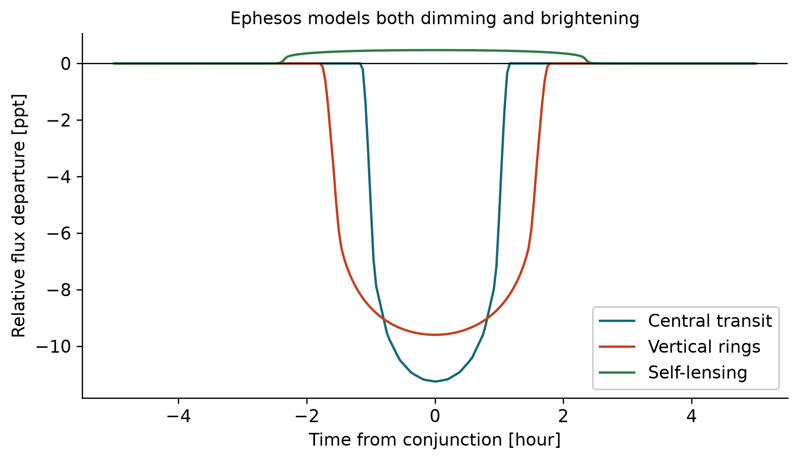


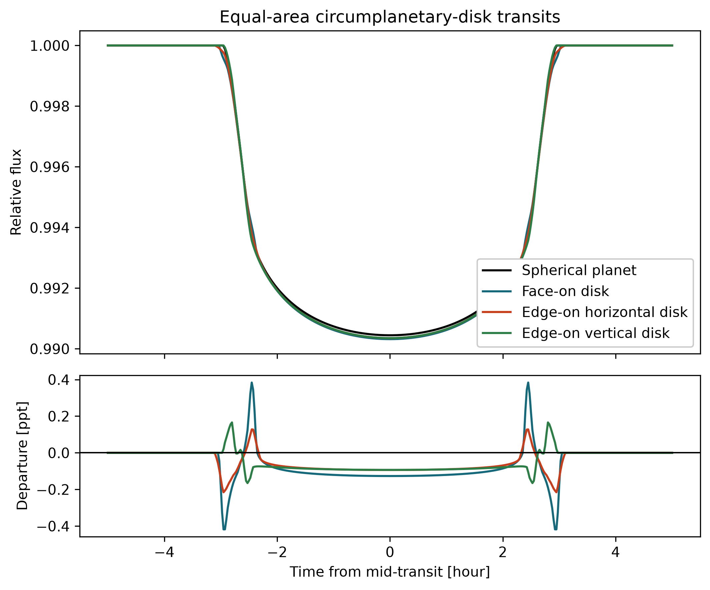

The exomoon example evaluates deterministic circular, coplanar planet-moon
geometries on a limb-darkened stellar grid. Its illustrative moon has a radius
of 0.28 planetary radii, an orbital separation of five planetary radii, and a
0.5-day orbital period. Leading and trailing orbital phases produce different
pre- and post-planet flux deficits. These curves are simulated examples, not
fits to observations or a dynamically self-consistent population. The grid
calculation scales with the number of time samples and the square of its pixel
count.

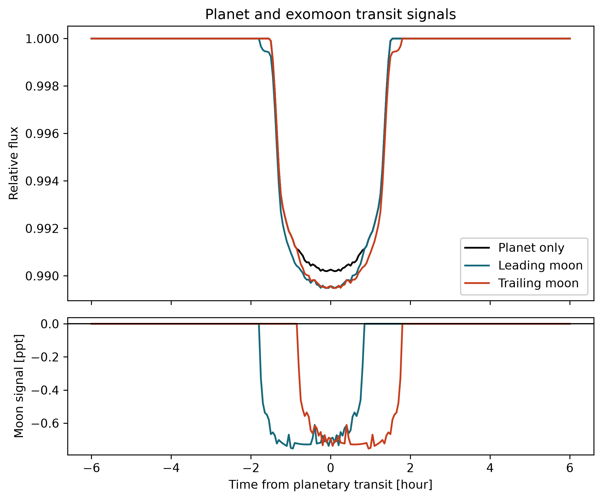

The exomoon timing pipeline advances the moon's orbital phase across 128
successive four-day planetary transits. It writes one CSV row per host transit
and a three-panel figure showing observable moon-transit offsets, their empirical
distribution, and the relation between moon phase and timing offset. The model
assumes circular coplanar motion and rejects configurations in which the moon's
projected orbital speed exceeds the planet's transit speed.

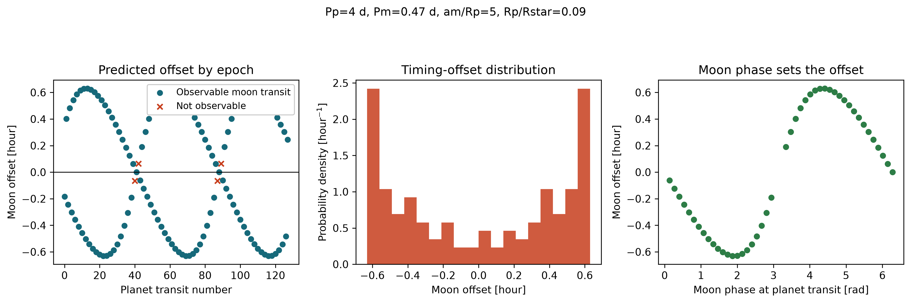

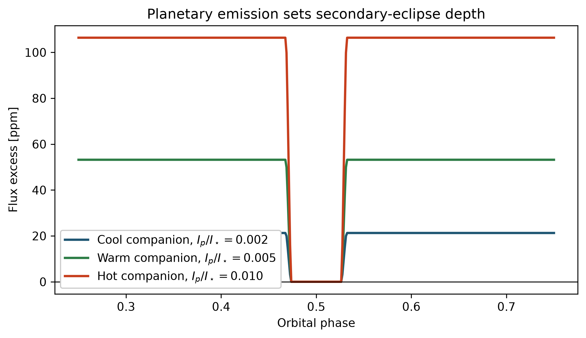

`evaluate_eclipse_mapping_model()` forward-models a supplied projected 2D
companion-brightness map through transit and secondary eclipse. Map values are
relative to the star's disk-averaged surface brightness, and the projected map
is held fixed during the modeled orbit. This deterministic example compares an
off-center hotspot with a uniform map of the same mean brightness, showing the
map-dependent ingress and egress signal.

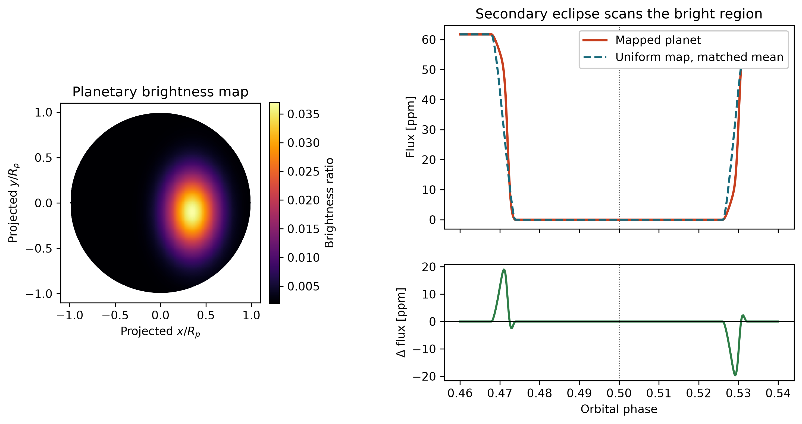

Single-system animations are written beside their scripts. The population summary
is written to `examples/run_population/population_features.png` and shows transit
depth, total duration, ingress duration, and equivalent width for 2,048 deterministic
oblate and ringed systems. It also shows each feature's departure from a matched
spherical planet with the same projected occulting area and orbit.

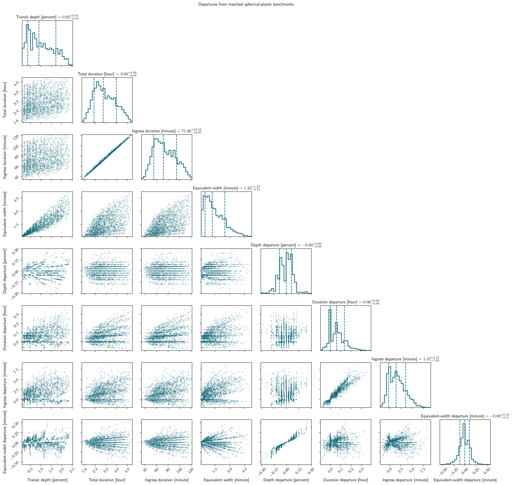

The ringed-occultor workflow generates face-on, horizontally projected, and
vertically projected ring examples. Each animation compares the ringed model
with spherical and oblate planets on the same orbit. Every shape has the same
projected occulting area, isolating light-curve differences caused by shape.

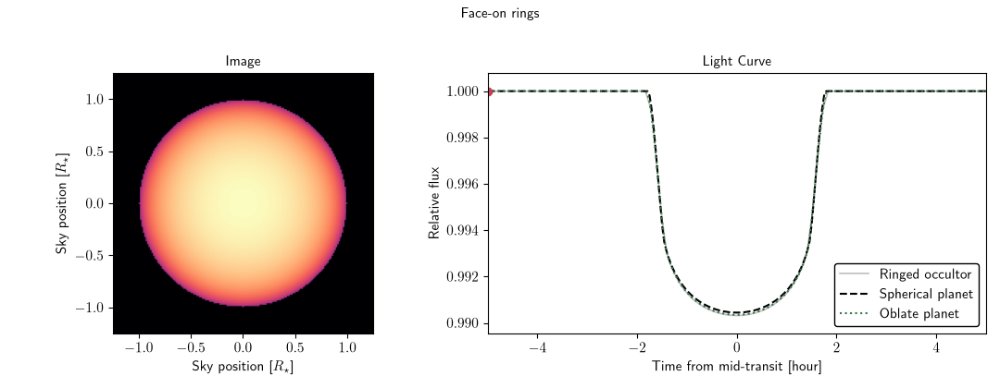

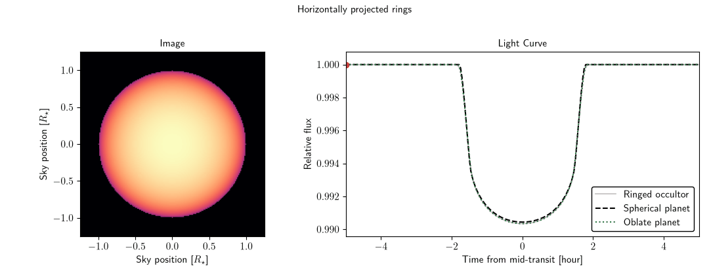


The AstroMusers example uses the complete group logo as the transiter and compares
its light curve with the logo's central circular component on the same orbit.

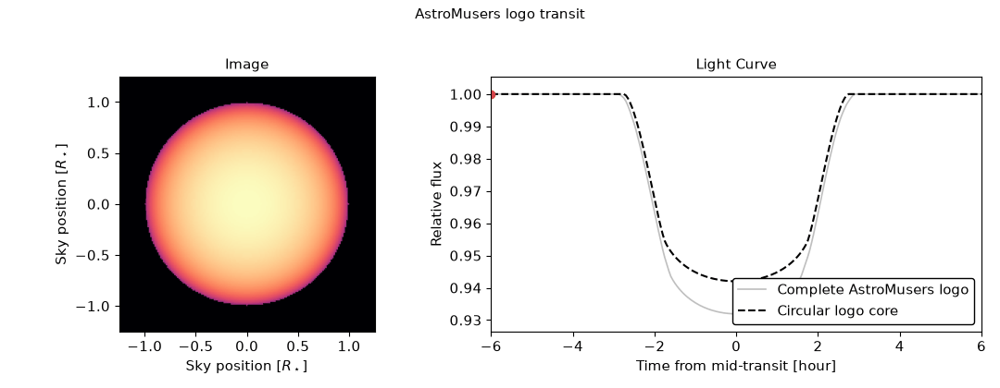

The self-lensing example compares deterministic 30-day binaries containing a
Jupiter-mass planet and $0.6\,M_\odot$ white-dwarf, $1.4\,M_\odot$
neutron-star, and $8\,M_\odot$ black-hole companions orbiting a solar analog.
The planet's roughly 0.04-ppm pulse has its own expanded-scale panel. A
controlled white-dwarf comparison isolates the effects of quadratic limb
darkening and projected impact parameter. These are explicit toy systems
rather than fits to observed data.

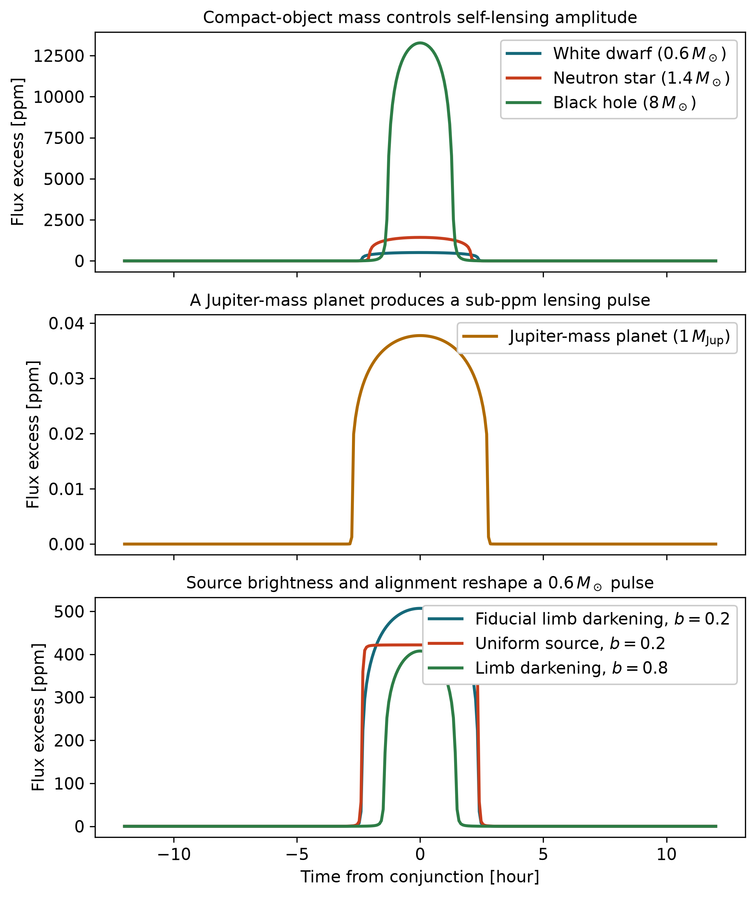

The known-self-lenser example compares Ephesos predictions with public Kepler
observations of KOI-3278 and KIC 8145411. The bundled compact tables contain
author-reduced simple-aperture photometry from Kruse and Agol (2014) for
KOI-3278 and quality-filtered Pre-search Data Conditioning photometry from the
Mikulski Archive for Space Telescopes for KIC 8145411. The latter uses the pulse
ephemeris and system parameters reported by Masuda et al. (2019). The Ephesos
curves use the published masses, radii, periods, and impact parameters without
fitting the plotted data.

The current Ephesos self-lensing interface assumes circular motion and omits
finite-lens occultation, third-light dilution, and Kepler cadence integration.
Its curves are therefore local finite-source approximations rather than
reproductions of the papers' eccentric-orbit fits. The data files retain source
and reduction metadata. Run `prepare_data.py` in the example directory to
reproduce them from the public sources when network access is available.

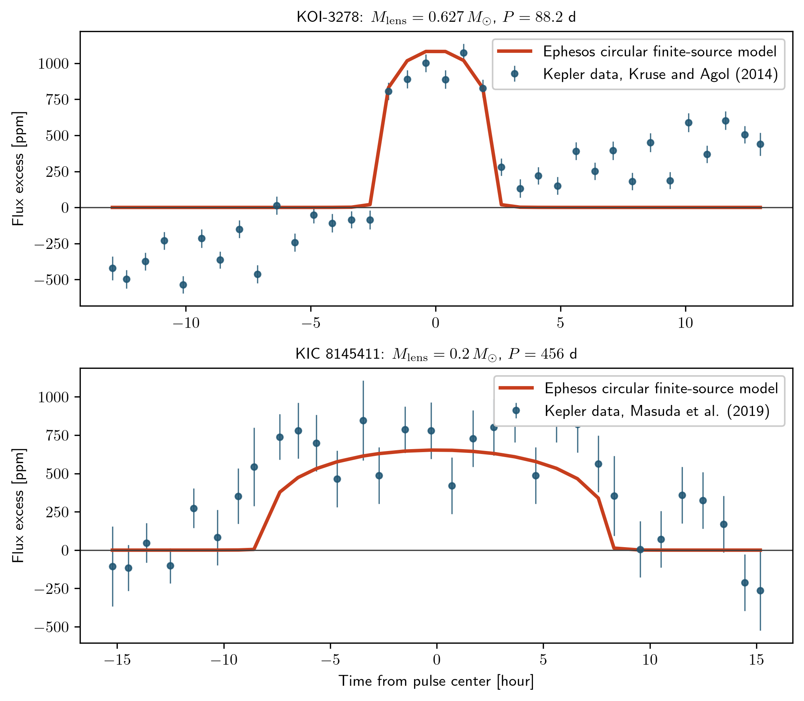

The circumplanetary-disk example compares face-on and edge-on disk silhouettes
with a spherical planet of equal projected occulting area. Its lower panel shows
the shape-induced departure from that spherical benchmark in parts per thousand.

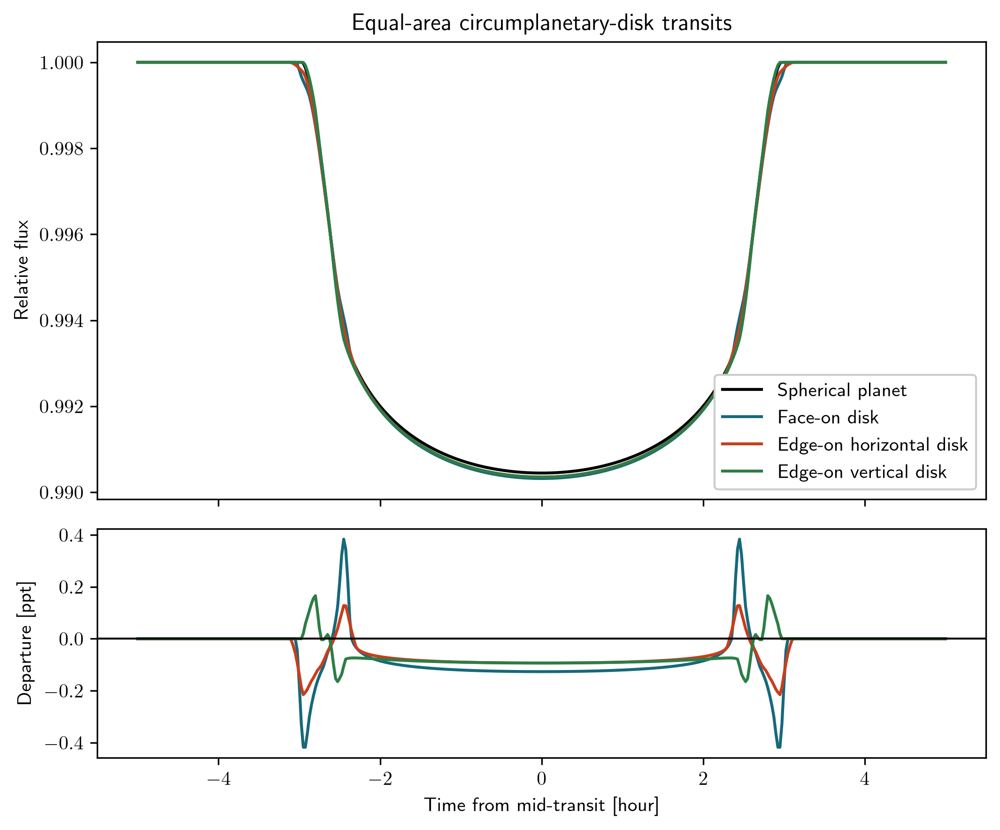

The simultaneous-transit example places two planets in an illustrative 3:2
resonant pair with a shared mid-transit time. The animation compares their
combined light curve with each planet's isolated contribution.

The compact-system example synthesizes an illustrative seven-planet
TRAPPIST-1-like resonant chain rather than fitting observations. It produces 21
transit events over 12 days. Its minimum adjacent separation is 6.54 mutual Hill
radii, exceeding the circular coplanar pairwise threshold of 3.46.

The reveal variant preserves the complete green light-curve history.

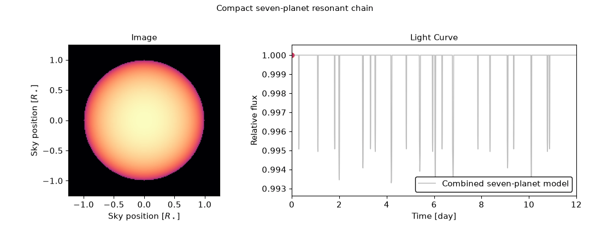

The trailing variant keeps only the latest three transit durations green.
Its playback slows by factors of 2 during full transits, 4 during ingress and
egress, and 6 during simultaneous transits.

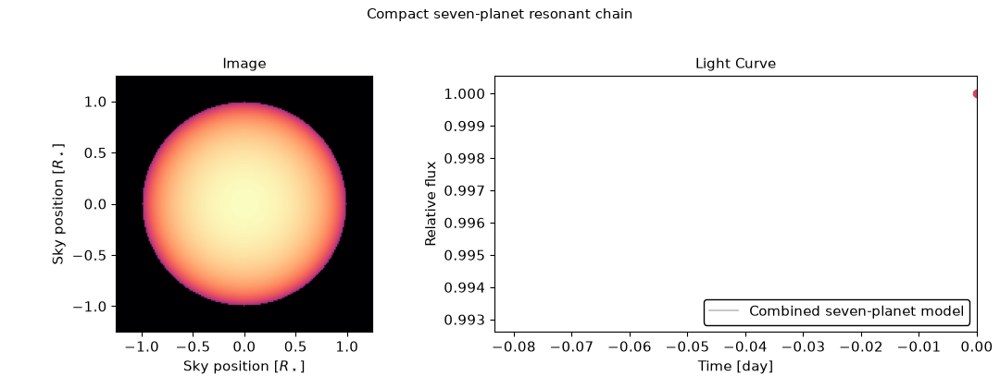

## Reusable plotting

`ephesos.save_light_curve_figure()` writes `png` output at 300 dots per inch or
vector `pdf` output. It uses a white background by default and accepts
`typeplotback="dark"`. `ephesos.save_light_curve_animation()` applies the same
labels, colors, typography, and opaque legend to GIF output. Its default
`light_curve_mode="reveal"` retains the complete green history. The alternative
`light_curve_mode="trailing"` shows a moving recent-history window over the gray
curve. That window defaults to three measured transit durations and can be set
explicitly with `history_duration` in the time-axis units.

## Inspecting the model
To understand a calculated light curve, I inspect:

- the input system geometry and stellar properties
- the intermediate brightness model or limb-darkening assumptions
- the resulting relative flux light curve
- residuals or comparisons with other models, when available

Changing one assumption and comparing the curves is often the quickest way to see which part of the system produces a feature.

